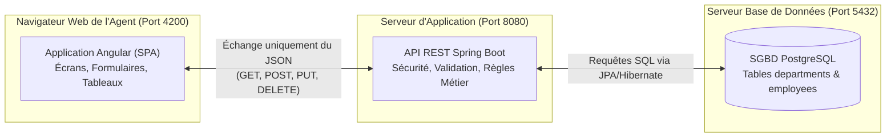
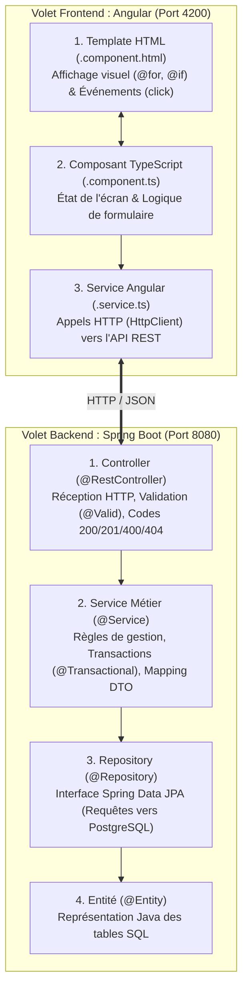

# Guide 01 : Comprendre l'Architecture Découplée & l'Approche Framework
*(Support de cours Jour 1 Matin — Pour ingénieurs expérimentés venant d'architectures classiques / Client-Serveur)*

> **Instructor Note (English):** Use this document during the first 90 minutes of Day 1 Morning with your coworker. Older engineers respect **clear architectural reasoning**. Once they understand *why* the Ministry of Finance / SIT is moving from coupled client-server or monolithic apps to **PostgreSQL + Spring Boot REST API + Angular SPA**, they will embrace the code instead of fighting the framework.

---

## 1. Du Modèle Classique à l'Architecture Découplée (Frontend / Backend)

### A. Comment fonctionnaient nos applications classiques ?
1. **Client-Serveur Lourd (Oracle Forms, Delphi, VB, WinDev) :**
   - Chaque poste client maintient une connexion directe à la base de données.
   - Les règles de gestion (calculs, contrôles) sont souvent mélangées dans les écrans ou dans des procédures stockées.
   - **Problème :** Difficile à déployer sur le Web, couplage fort avec le poste client, et impossible d'exposer les mêmes services à un portail web, une application mobile ou une autre direction du Ministère.
2. **Web Monolithique Classique (JSP, PHP procédural, ASP classique) :**
   - Le serveur exécute la requête SQL et génère une page HTML complète à chaque clic.
   - **Problème :** À chaque clic sur un bouton ou un filtre, toute la page se recharge (clignotement), et le code HTML est mélangé avec le code métier et les requêtes SQL.

### B. Le Nouveau Standard du Ministère (Architecture Découplée REST)

Dans l'architecture cible **Spring Boot + Angular + PostgreSQL**, nous séparons strictement l'application en **deux programmes indépendants** qui communiquent uniquement par des messages **JSON** via le protocole **HTTP (API REST)** :



### Les 3 Règles d'Or de cette Architecture
1. **Angular ne parle JAMAIS directement à PostgreSQL.** Il ne connaît même pas l'existence du SQL. Il envoie et reçoit uniquement du **JSON**.
2. **Spring Boot ne génère JAMAIS de page HTML.** Il agit comme un "guichet sécurisé" (API REST) qui vérifie les droits, applique les règles métier, interroge PostgreSQL et renvoie du JSON.
3. **Le Contrat JSON est le traité officiel entre le Frontend et le Backend :**
   ```json
   {
     "id": 1,
     "matricule": "FIN-2026-001",
     "firstName": "Karim",
     "lastName": "BENALI",
     "jobTitle": "Architecte Logiciel Principal",
     "salary": 145000.00,
     "status": "ACTIVE",
     "departmentCode": "SIT"
   }
   ```

---

## 2. Démystifier le Style "Framework" (Le Principe d'Hollywood)

> **Question fréquente des ingénieurs seniors :** *"Où est la fonction `main()` qui appelle mon écran ou ma requête ? Pourquoi ajoute-t-on des `@RestController`, `@Service` ou `@Component` au-dessus des classes ?"*

### Bibliothèque Classique vs Framework Moderne
- **En programmation procédurale / classique :** C'est **votre code** qui contrôle le flux d'exécution et qui instancie les objets (`new ConnexionBDD()`, `new EcranEmploye()`).
- **Avec un Framework (Spring Boot ou Angular) :** C'est l'**Inversion de Contrôle (IoC)** — souvent appelée le *Principe d'Hollywood : « Ne nous appelez pas, c'est nous qui vous appellerons »*.

### Comment fonctionne l'Injection de Dépendances (DI) ?
Au lieu d'écrire `new EmployeeRepository()` à l'intérieur de votre Service :
1. Vous collez une étiquette (**Annotation** en Java `@Service`, ou **Décorateur** en Angular `@Injectable`) sur votre classe.
2. Au démarrage, le Framework scanne toutes les étiquettes et crée **une seule instance en mémoire (Singleton)** de chaque composant.
3. Quand votre `EmployeeController` déclare dans son constructeur :
   ```java
   public EmployeeController(EmployeeService employeeService) {
       this.employeeService = employeeService;
   }
   ```
   Spring Boot lui fournit automatiquement l'instance prête à l'emploi !

---

## 3. Architecture Interne en Couches (Backend vs Frontend)

Pour que le code reste propre et maintenable par les 73 informaticiens du Ministère, chaque couche a une responsabilité unique :



---

## 4. Monolithe Modulaire vs Microservices (Objectif du Schéma Directeur)

Le cahier des charges de la formation mentionne : *"Développer des microservices ou des applications monolithiques modulaires avec Spring Boot."* Voici comment choisir entre les deux au Ministère des Finances :

| Critère | Monolithe Modulaire (Recommandé pour démarrer) | Architecture Microservices |
| :--- | :--- | :--- |
| **Définition** | Une seule application Spring Boot déployée, mais découpée en packages métiers stricts (`paie`, `carriere`, `formation`). | Plusieurs applications Spring Boot distinctes (chacune avec son propre serveur et sa propre base PostgreSQL) qui communiquent par réseau. |
| **Avantages** | Simple à développer, déboguer, tester et déployer ; transactions SQL (`@Transactional`) garanties. | Scalabilité indépendante (ex: renforcer uniquement le microservice de calcul de paie en fin de mois). |
| **Complexité** | Faible à Moyenne. | Élevée (nécessite la gestion des pannes réseau, API Gateway, supervision distribuée). |
| **Conseil SIT** | Commencez **toujours** par un **Monolithe Modulaire bien découplé** (avec DTOs et Services propres). Si un module critique doit être isolé plus tard, il pourra être extrait en Microservice facilement. | À réserver lorsque des équipes distinctes gèrent des domaines métiers à forte charge indépendante. |
