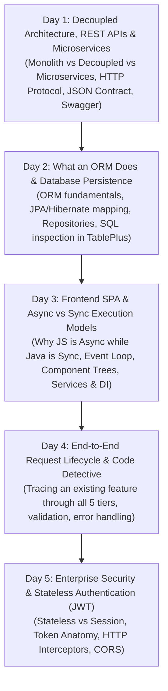

# Plan: Conceptual Architecture Training & 5-Day Curriculum Strategy (Updated & Approved)
## Target: Understanding Pre-Existing Decoupled Enterprise Applications
**Stack:** Spring Boot 3 + PostgreSQL + Angular 18  
**IDEs & Tools:** Eclipse (Spring Boot), VS Code (Angular), TablePlus (Database Client)  
**Language:** 100% English

---

## 1. Updated 5 Conceptual Pillars

### Day 1: Decoupled Architecture, REST APIs & Microservices
- **Monolith vs Decoupled vs Microservices:**
  - Traditional Monoliths: Single runtime binary, tightly coupled UI and SQL.
  - Decoupled Tier Architecture: SPA (port 4200) $\leftrightarrow$ REST API (port 8080) $\leftrightarrow$ DB (port 5432).
  - Microservices vs Monoliths: When and why enterprises break a backend into multiple independent services (service boundaries, independent deployments, network overhead).
- **The REST API Contract:**
  - HTTP verbs (`GET`, `POST`, `PUT`, `DELETE`), headers, status codes (`200`, `201`, `400`, `404`, `409`, `500`).
  - JSON as the universal interchange contract.
  - OpenAPI / Swagger UI as a living executable contract (`/swagger-ui.html`).
- **Tooling:** Running the app with dead-simple one-click scripts, opening Eclipse, VS Code, and TablePlus.

### Day 2: What an ORM Does & Database Persistence (JPA / Hibernate)
- **Direct Explanation of What an ORM Does:**
  - Bridges relational tables in PostgreSQL to object instances in Java without writing repetitive SQL strings.
  - How an ORM translates `employeeRepository.save(employee)` into `INSERT INTO employees ...` under the hood.
  - Entities (`@Entity`, `@Table`, `@Id`, `@GeneratedValue`).
  - Relational mapping: `@ManyToOne` and foreign keys.
  - Queries without SQL: Spring Data JPA method name conventions (`existsByEmailIgnoreCase`).
  - Transactions: What `@Transactional` does (`BEGIN ... COMMIT / ROLLBACK`).
- **Tooling & Inspection:** Inspecting the database directly in **TablePlus**, cross-referencing generated SQL queries in Eclipse console.

### Day 3: Frontend SPA Concepts & Async vs Sync (JavaScript vs Java)
- **The Deep-Dive: Why JavaScript is Async while Java is Sync:**
  - **Java Thread Model:** Multi-threaded, synchronous blocking I/O (Thread-per-request). When Java waits for PostgreSQL, the thread pauses.
  - **JavaScript Engine Model:** Single-threaded event loop. If JavaScript blocked for a network request, the entire browser window would freeze (unresponsive mouse/UI).
  - Why JS uses callbacks, Promises, and RxJS `Observable` (`.subscribe()`) for non-blocking I/O.
- **Single Page Application (SPA) Mechanics:**
  - Browser memory model: `index.html` loads once, component tree swaps inside `<router-outlet>`.
  - Component hierarchy (`.component.ts` logic + `.component.html` template).
  - Dependency Injection in Frontend (`@Injectable` services vs global variables).

### Day 4: Full Request Lifecycle & "The Code Detective"
- **Tracing a Feature End-to-End:**
  - Tracing a button click to the database:
    1. UI Event (`(click)="onSubmit()"`) in VS Code
    2. Frontend Service (`HttpClient.post()`)
    3. Browser Network Wire (F12 Network tab inspection)
    4. Spring Controller (`@PostMapping`, `@RequestBody`) in Eclipse
    5. DTO Validation (`@Valid`, HTTP 400 response)
    6. Service Business Layer (`@Transactional`)
    7. ORM Repository (`JpaRepository.save()`)
    8. PostgreSQL database row insertion (viewed in TablePlus)
    9. JSON Response serialized and returned to browser
    10. Angular reactivity / DOM update without reload.
- **Client Validation vs Server Validation:** Why UI validation is user-friendly guidance, but the backend is the only security boundary.

### Day 5: Enterprise Security & Stateless Authentication (JWT)
- **Stateful Sessions vs Stateless Tokens:**
  - Why decoupled systems don't use server sessions (HTTP cookies / `JSESSIONID`).
  - JSON Web Token (JWT) Anatomy: Header (Algorithm), Payload (Claims: username, role, expiration), Signature.
  - Token storage in frontend (`sessionStorage`).
  - HTTP Interceptors: Automatically appending `Authorization: Bearer <token>` to outbound requests.
  - CORS (Cross-Origin Resource Sharing): Why the browser blocks cross-port requests and how Spring Boot allows it.

---

## 2. Deliverables Checklist

1. **Dead-Simple Run Guide & One-Click Launchers:**
   - `docs/01-quick-start-and-run-guide.md`
   - `start-all.bat` & `start-all.ps1`
2. **5 English Presentation Slide Decks (`docs/presentations/`):**
   - `day-1-decoupled-architecture-rest-microservices.md`
   - `day-2-orm-persistence-jpa.md`
   - `day-3-frontend-spa-and-async.md`
   - `day-4-fullstack-request-lifecycle.md`
   - `day-5-security-jwt-and-authentication.md`
3. **Instructor Daily Teaching Playbook (`docs/daily-teaching-guide.md`):**
   - Timing, analogies, questions to ask the engineers, Eclipse/TablePlus/VS Code guidance.
4. **Live Demo & Inspection Guide (`docs/demo-guide-and-inspection.md`):**
   - Step-by-step inspections using Chrome DevTools, TablePlus, Eclipse console, and Swagger UI.
5. **Git Save-Point Branching System & Script:**
   - 5 tagged branches published to GitHub repository for student safe checkpoints.
