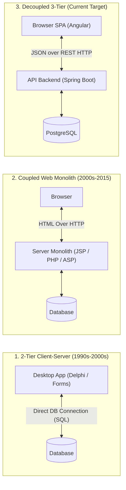

# Day 1 Presentation: Decoupled Web Architecture, REST APIs & Microservices
**Target Audience:** Senior Enterprise Engineers  
**Duration:** 1 Day (Morning: Concepts & Architecture / Afternoon: REST Contracts & Hands-on Exploration)

---

## Slide 1: Welcome & Course Objectives
- **Context:** Modernization of enterprise applications at the Ministry of Finance.
- **The Core Goal:** Understanding the architecture, communication patterns, and design principles of modern decoupled applications.
- **Focus:** Concepts, architectural trade-offs, and reading existing systems (not memorizing syntax).
- **Today's Agenda:**
  1. Evolution: 2-Tier Client-Server $\rightarrow$ Monoliths $\rightarrow$ Decoupled Tiers $\rightarrow$ Microservices.
  2. The REST API Paradigm: Verbs, Status Codes, Statelessness, and JSON Contracts.
  3. Interactive API Exploration with Swagger UI & Chrome DevTools.

---

## Slide 2: The Evolution of Enterprise Applications



### Why Did Enterprise Systems Evolve?
- **2-Tier Client-Server (Oracle Forms, Delphi, PowerBuilder):**
  - Business logic mixed directly inside UI screens or stored procedures.
  - Desktop deployment nightmare (installing Oracle client / DLLs on 500 employee PCs).
  - Heavy database connection contention (every desktop PC holds an open DB socket).
- **Coupled Web Monoliths (JSP, PHP, ASP.NET WebForms):**
  - Web accessible, but server generates the full HTML on every click.
  - Clicking a button reloads the entire page (flickering, re-rendering, slow).
  - Mobile apps or third-party ministry portals cannot reuse the backend because HTML is mixed with data.

---

## Slide 3: What is a Decoupled Architecture?

In our stack:
- **Frontend (Angular on port 4200):**
  - Runs **entirely inside the user's browser**.
  - Responsible for UI rendering, user interactions, local form validation.
  - **Has ZERO direct access to PostgreSQL.**
- **Backend (Spring Boot on port 8080):**
  - Runs on the application server.
  - Exposes a secure HTTP gateway (REST API).
  - Handles business logic, data validation, database transactions, and security.
  - **Generates ZERO HTML. It only speaks JSON.**
- **Database (PostgreSQL on port 5432):**
  - Relational storage for structured records (`departments`, `employees`).

---

## Slide 4: Monoliths vs. Decoupled vs. Microservices

| Architectural Style | Structure | Communication | Pros | Cons / When to Avoid |
| :--- | :--- | :--- | :--- | :--- |
| **Traditional Coupled Monolith** | Single code repo, single deployable binary (`.war`), generates HTML. | Direct in-memory method calls. | Simple deployment; single codebase. | Poor user experience (full page reloads); tight coupling; UI cannot be reused. |
| **Decoupled Tier (Modular Backend + SPA)** | Separate Frontend SPA (Angular) and Backend REST API (Spring Boot). | HTTP / JSON across the network. | Rich UI (no page reloads); backend is reusable by mobile, web, and other ministries; clean team boundaries. | Requires network coordination and CORS handling. **(Recommended starting point!)** |
| **Microservices Architecture** | Backend is split into 10+ independent services (Payroll Service, Career Service, Auth Service). | Network calls (REST, gRPC, Kafka queues) between services. | Extreme horizontal scalability; teams deploy independently. | High complexity; network latency; distributed transactions (no simple `@Transactional`); complex monitoring. |

> **Key Rule for Ministry Systems:** Start with a **clean, modular decoupled system**. Only migrate bounded contexts to microservices when separate teams need independent deployment lifecycles or distinct scalability requirements.

---

## Slide 5: The REST API Paradigm (Representational State Transfer)

### The 4 Principles of REST
1. **Resource-Oriented URLs:**
   - URLs name **nouns (resources)**, not actions:
   - ✅ `/api/employees` (Collection of employees)
   - ✅ `/api/employees/5` (A specific employee)
   - ❌ `/api/getEmployeeById?id=5` (RPC style - avoid in REST)
   - ❌ `/api/deleteEmployee` (Action in URL - avoid in REST)
2. **HTTP Verbs as Standard Actions:**
   - `GET` $\rightarrow$ Retrieve resource (Safe & Idempotent)
   - `POST` $\rightarrow$ Create a new resource
   - `PUT` $\rightarrow$ Update / Replace an existing resource
   - `DELETE` $\rightarrow$ Remove a resource
3. **Statelessness:**
   - Each HTTP request from the client must contain **all** the information needed to understand and process the request.
   - The server does not maintain conversational UI memory between calls.
4. **Standard HTTP Status Codes:**
   - `200 OK` $\rightarrow$ Successful read or update
   - `201 Created` $\rightarrow$ Resource successfully created (with `POST`)
   - `204 No Content` $\rightarrow$ Successful deletion (empty body)
   - `400 Bad Request` $\rightarrow$ Client input failed validation (e.g. invalid email)
   - `404 Not Found` $\rightarrow$ ID does not exist in database
   - `409 Conflict` $\rightarrow$ Unique constraint violation (e.g. matricule already exists)
   - `500 Internal Server Error` $\rightarrow$ Unexpected server crash / bug

---

## Slide 6: The JSON Contract (The Language-Agnostic Wire Treaty)

Between Java (Backend) and TypeScript (Frontend), data travels as a UTF-8 text string formatted as **JSON (JavaScript Object Notation)**:

```json
{
  "id": 1,
  "matricule": "FIN-2026-001",
  "firstName": "Karim",
  "lastName": "BENALI",
  "email": "k.benali@finances.gov",
  "salary": 145000.00,
  "hireDate": "2018-03-15",
  "status": "ACTIVE",
  "departmentId": 1,
  "departmentCode": "SIT",
  "departmentName": "Système d'Information du Trésor"
}
```

### Why JSON Won:
- Human readable and text based.
- Built-in native support in every programming language (Java, JavaScript, Python, C#, PHP).
- Lightweight compared to SOAP / XML (no heavy envelopes or tags).

---

## Slide 7: Living API Documentation — Swagger UI / OpenAPI

In legacy systems, APIs were documented in Word documents or PDFs that became outdated within 2 months.

- In modern Spring Boot, **OpenAPI (Swagger)** generates documentation **directly from the running Java code**:
- Open: `http://localhost:8080/swagger-ui.html`
- Features:
  - Interactive testing of `GET`, `POST`, `PUT`, `DELETE`.
  - Exact JSON request schema and required fields.
  - Real status code responses (`200`, `400`, `404`).

---

## Slide 8: Afternoon Hands-on Exploration Checklist

1. Open `http://localhost:8080/swagger-ui.html`.
2. Execute `GET /api/employees`:
   - Inspect the returned HTTP status (`200`).
   - Inspect the returned JSON payload.
3. Execute `POST /api/employees` with an empty email:
   - Notice the `400 Bad Request` response with field errors.
4. Open the browser to `http://localhost:4200`:
   - Press `F12` $\rightarrow$ Open **Network** tab $\rightarrow$ Filter by `Fetch/XHR`.
   - Click **Refresh** in the app.
   - Observe the exact HTTP request `GET http://localhost:8080/api/employees` fired over the wire!
