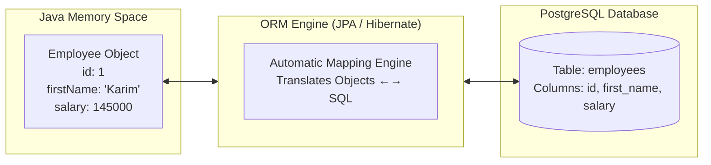
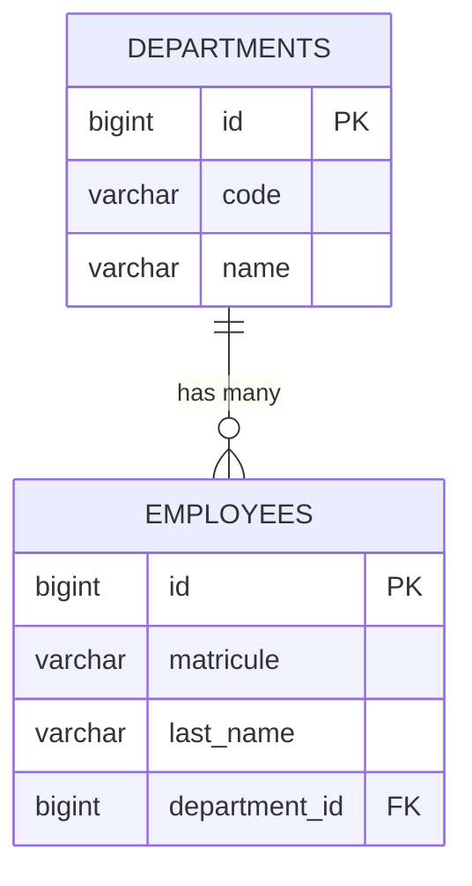

# Day 2 Presentation: What an ORM Does & Database Persistence (JPA / Hibernate)
**Target Audience:** Senior Enterprise Engineers  
**Duration:** 1 Day (Morning: ORM Concepts, Entities & Repositories / Afternoon: Transactions & SQL Inspection)

---

## Slide 1: Welcome to Day 2 — The Persistence Tier
- **Yesterday's Takeaway:** The REST API exposes resources as JSON endpoints over HTTP.
- **Today's Question:** How does the Java application store and retrieve those resources from a relational database (PostgreSQL) without writing hundreds of lines of repetitive SQL?
- **Today's Agenda:**
  1. What an ORM (Object-Relational Mapping) actually does.
  2. JPA Entities (`@Entity`, `@Table`, `@Column`, `@Id`).
  3. Managing Relationships (`@ManyToOne` & Foreign Keys).
  4. Spring Data Repositories (CRUD without SQL strings).
  5. Transactions (`@Transactional`) & Inspecting Generated SQL in TablePlus.

---

## Slide 2: What Does an ORM (Object-Relational Mapping) Do?

### Without an ORM (The Old JDBC / PreparedStatement Way):
In classical Java or C, to fetch an employee, you had to write:
```java
// 1. Open database connection
Connection conn = DriverManager.getConnection(url, user, pass);
// 2. Write raw SQL string
PreparedStatement ps = conn.prepareStatement("SELECT id, first_name, last_name, salary FROM employees WHERE id = ?");
ps.setLong(1, 10L);
// 3. Loop through result set and manually map column by column
ResultSet rs = ps.executeQuery();
if (rs.next()) {
    Employee emp = new Employee();
    emp.setId(rs.getLong("id"));
    emp.setFirstName(rs.getString("first_name"));
    emp.setLastName(rs.getString("last_name"));
    emp.setSalary(rs.getBigDecimal("salary"));
}
// 4. Remember to close ResultSet, PreparedStatement, and Connection!
```
*If a table has 30 columns, you write 30 lines of tedious manual mapping. If you rename a column, you get a runtime error.*

### With an ORM (Hibernate / JPA):
The ORM acts as an automated translation engine between **Java Classes** and **SQL Tables**:



- When you call: `employeeRepository.save(employee);`
  The ORM automatically generates:
  `INSERT INTO employees (first_name, last_name, salary, ...) VALUES (?, ?, ?, ...)`
- When you call: `employeeRepository.findById(1L);`
  The ORM automatically generates:
  `SELECT * FROM employees WHERE id = ?` and instantiates the Java `Employee` object!

---

## Slide 3: Anatomy of a JPA Entity (`@Entity`)

Open [`backend/src/main/java/com/finances/ems/entity/Employee.java`](../../backend/src/main/java/com/finances/ems/entity/Employee.java) in Eclipse:

```java
@Entity
@Table(name = "employees")
public class Employee {

    @Id
    @GeneratedValue(strategy = GenerationType.IDENTITY)
    private Long id;

    @Column(nullable = false, unique = true, length = 30)
    private String matricule;

    @Column(name = "first_name", nullable = false, length = 80)
    private String firstName;

    @Column(nullable = false, precision = 12, scale = 2)
    private BigDecimal salary;

    @Enumerated(EnumType.STRING)
    @Column(nullable = false, length = 20)
    private EmployeeStatus status;
}
```

### Key Annotations to Explain:
1. **`@Entity`:** Tells Spring and Hibernate: *"This class represents a persistent table in PostgreSQL."*
2. **`@Table(name = "employees")`:** The physical table name in PostgreSQL.
3. **`@Id` & `@GeneratedValue(strategy = GenerationType.IDENTITY)`:** Maps directly to PostgreSQL `BIGSERIAL PRIMARY KEY` (auto-incremented by the database sequence).
4. **`@Column(name = "first_name")`:** Maps Java camelCase (`firstName`) to SQL snake_case (`first_name`).
5. **`@Enumerated(EnumType.STRING)`:** Stores `'ACTIVE'` as text in the DB instead of integer `0` (which causes maintenance bugs).

---

## Slide 4: Relational Mapping — Handling Foreign Keys (`@ManyToOne`)

In relational databases, tables are linked via **Foreign Keys**. How does an ORM represent this?



In [`Employee.java`](../../backend/src/main/java/com/finances/ems/entity/Employee.java):
```java
@ManyToOne(fetch = FetchType.EAGER, optional = false)
@JoinColumn(name = "department_id", nullable = false)
private Department department;
```

### What this achieves:
- Instead of storing a raw integer `department_id`, the `Employee` object holds a direct reference to the **`Department`** object!
- `emp.getDepartment().getName()` retrieves the department directly.
- The `@JoinColumn(name = "department_id")` annotation specifies the exact foreign key column created in PostgreSQL.

---

## Slide 5: Spring Data Repositories — Queries Without SQL

Open [`DepartmentRepository.java`](../../backend/src/main/java/com/finances/ems/repository/DepartmentRepository.java) and [`EmployeeRepository.java`](../../backend/src/main/java/com/finances/ems/repository/EmployeeRepository.java):

```java
@Repository
public interface DepartmentRepository extends JpaRepository<Department, Long> {
    Optional<Department> findByCodeIgnoreCase(String code);
    boolean existsByCodeIgnoreCase(String code);
}
```

### The Magic of `JpaRepository`:
- You do **not** write an implementation class. Spring generates the SQL and runtime bytecode automatically.
- Built-in methods out of the box:
  - `findAll()`, `findById(id)`, `save(entity)`, `deleteById(id)`, `count()`.
- **Query Method Derivation:**
  When you declare: `existsByEmailIgnoreCase(String email)`
  Spring parses the method name and generates:
  `SELECT count(*) > 0 FROM employees WHERE LOWER(email) = LOWER(?)`!
- **Custom JPQL Queries (`@Query`):**
  When you need complex multi-criteria filters, write JPQL (Java Persistence Query Language) using entity class and property names instead of database-specific SQL dialect.

---

## Slide 6: Database Transactions in Modern Frameworks (`@Transactional`)

In classical database systems, you wrote:
`BEGIN TRANSACTION; ... COMMIT; / ROLLBACK;`

In Spring Boot:
```java
@Transactional
public EmployeeResponseDto createEmployee(EmployeeRequestDto dto) {
    // 1. Check uniqueness
    // 2. Retrieve Department
    // 3. Save new Employee
    return toResponseDto(saved);
}
```

### How `@Transactional` Works:
1. Spring intercepts the method call.
2. It borrows a connection from the HikariCP connection pool and starts a transaction (`BEGIN`).
3. If the method finishes normally, Spring commits the transaction (`COMMIT`).
4. If an unhandled `RuntimeException` is thrown (e.g. `DuplicateResourceException`), Spring automatically rolls back all database operations (`ROLLBACK`).

---

## Slide 7: Inspecting ORM Behavior Live in TablePlus & Eclipse

### What We Can See in TablePlus:
1. Connect to `localhost:5432` $\rightarrow$ `ems_db`.
2. Inspect table structure: notice columns, foreign key constraint `fk_employee_department`, and unique indexes created by Hibernate.
3. Edit a row in TablePlus, click Save, then query via Swagger UI: notice the immediate update!

### What We Can See in the Eclipse Console:
Because `application.yml` has `spring.jpa.show-sql: true` and `format_sql: true`, every API request prints the exact formatted SQL generated by Hibernate to the console:
```sql
Hibernate: 
    select
        e1_0.id,
        e1_0.matricule,
        e1_0.first_name,
        e1_0.salary 
    from
        employees e1_0 
    where
        e1_0.id=?
```

---

## Slide 8: Afternoon Hands-on Activity (Code Reading & Inspection)

1. Open **TablePlus** and explore the `departments` and `employees` tables.
2. In Eclipse, open [`DataInitializer.java`](../../backend/src/main/java/com/finances/ems/config/DataInitializer.java):
   - Trace how the 4 departments and 6 initial employees are created using `repository.save()`.
3. In Swagger UI, execute `POST /api/employees` to create a new employee:
   - Check the Eclipse console to see the generated `INSERT INTO employees ...` SQL.
   - Switch to TablePlus, refresh the `employees` table, and verify the new row!
4. In Swagger UI, try to insert the exact same matricule again:
   - Observe the `409 Conflict` error and verify that no duplicate row was created in TablePlus.
