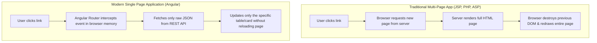
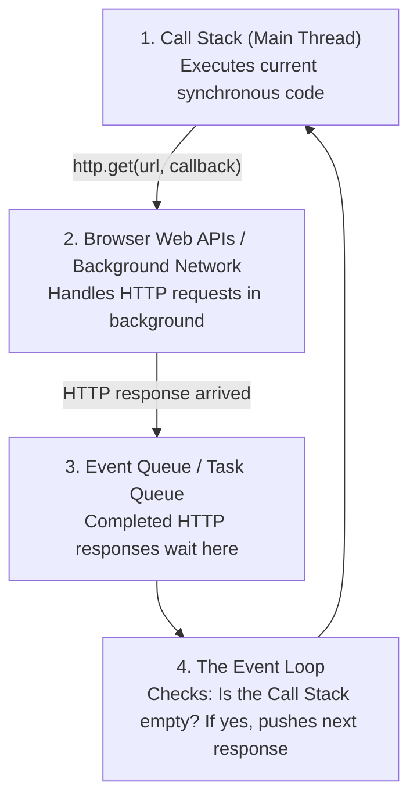
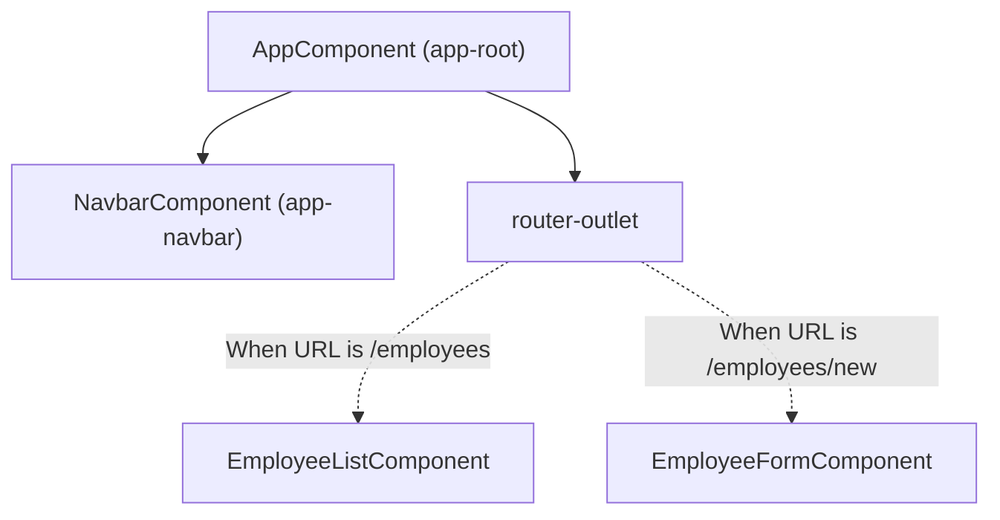

# Day 3 Presentation: Frontend SPA Concepts & The Execution Models (Async vs Sync)
**Target Audience:** Senior Enterprise Engineers  
**Duration:** 1 Day (Morning: SPA & Async vs Sync Execution Models / Afternoon: Angular Architecture & Observables)

---

## Slide 1: Welcome to Day 3 — The Client Runtime Tier
- **Where We Are:** We have a working REST API on port 8080 and PostgreSQL on port 5432.
- **Today's Focus:** The browser execution environment.
- **The Big Architectural Question:**
  *Why does JavaScript execute code asynchronously while Java executes code synchronously? Why do we need Observables, Promises, and callbacks in the browser?*
- **Today's Agenda:**
  1. Single Page Application (SPA) vs Multi-Page Application (MPA).
  2. The Deep Dive: **Synchronous Execution (Java) vs Asynchronous Execution (JavaScript)**.
  3. The JavaScript Event Loop & Non-Blocking I/O.
  4. Angular Component Trees & Inversion of Control (Dependency Injection).
  5. The RxJS `Observable` pattern for consuming REST APIs.

---

## Slide 2: Single Page Application (SPA) vs Multi-Page Application (MPA)



### Key Differences:
- In an MPA, the browser window is reloaded on every user action. The server controls screen navigation.
- In an SPA, the browser downloads `index.html` and JavaScript **once**. Navigation happens in client memory. The user experience is instantaneous, like a desktop application.

---

## Slide 3: The Big Question — Why is Java Synchronous while JavaScript is Asynchronous?

### The Java Model: Multi-Threaded & Synchronous (Blocking)
- When a client sends a request to Spring Boot (`GET /api/employees`), Tomcat allocates **one dedicated operating system thread** from a thread pool to handle that request.
- If that thread needs to query PostgreSQL:
  ```java
  // The thread BLOCKS here and goes to sleep waiting for the database disk / network:
  List<Employee> list = employeeRepository.findAll(); 
  // Once PostgreSQL replies (e.g. 15ms later), the thread wakes up and proceeds:
  return ResponseEntity.ok(list);
  ```
- **Why this works in Java:**
  If 50 users connect simultaneously, Tomcat assigns 50 separate threads. One thread waiting for PostgreSQL does not freeze the other 49 threads.

---

## Slide 4: Why Can't JavaScript Do What Java Does?

### The Browser Constraint: Single-Threaded UI Engine
- The browser JavaScript engine (V8 in Chrome) runs on a **single main execution thread**.
- That single thread is responsible for:
  1. Executing JavaScript code.
  2. Listening to user mouse clicks and keystrokes.
  3. Rendering pixels to the physical computer screen (CSS layout, animations).

### What Would Happen if JavaScript Used Synchronous Blocking Calls?
If JavaScript executed:
```javascript
// HYPOTHETICAL SYNCHRONOUS CODE IN BROWSER:
let employees = http.getSync("http://localhost:8080/api/employees"); // WAITS 200ms
displayTable(employees);
```
During those 200 milliseconds:
- The browser window would **completely freeze**.
- Mouse clicks would not register.
- Scrolling would stop.
- The browser would display: *"Page unresponsive: Wait or Kill?"*

> **Fundamental Law of the Web:** **The browser UI thread must NEVER be blocked.** Everything involving network I/O, timers, or disk must be **Asynchronous**.

---

## Slide 5: The Solution — The JavaScript Event Loop

How does JavaScript handle high-speed operations on a single thread?



### The Sequence:
1. JavaScript executes `http.get('/api/employees')`.
2. It registers a **callback** (or Observable subscription) and **immediately returns control to the UI**. The screen stays responsive!
3. The browser networking subsystem handles the HTTP traffic in the background.
4. When the JSON arrives from Spring Boot, the callback is placed in the **Event Queue**.
5. As soon as the main thread is idle, the **Event Loop** executes the callback to render the table.

---

## Slide 6: Asynchrony in Modern Angular — The RxJS `Observable`

In Angular, HTTP calls return an **`Observable<T>`** from the RxJS library.

Open [`frontend/src/app/services/employee.service.ts`](../../frontend/src/app/services/employee.service.ts) in VS Code:
```typescript
getEmployees(): Observable<Employee[]> {
  return this.http.get<Employee[]>(this.apiUrl);
}
```

And in [`employee-list.component.ts`](../../frontend/src/app/components/employee-list/employee-list.component.ts):
```typescript
this.employeeService.getEmployees().subscribe({
  next: (data) => {
    this.employees = data; // Ran asynchronously when JSON arrives
    this.isLoading = false;
  },
  error: (err) => {
    this.errorMessage = "Failed to load employees";
  }
});
```

### The 10-Second Mental Model:
- Calling `this.employeeService.getEmployees()` does **NOT** return the array of employees immediately.
- It returns an **Observable** (a stream / subscription contract).
- The `.subscribe({ next: ... })` method tells Angular: *"When the HTTP response arrives in the future, run this code."*

---

## Slide 7: Component Hierarchy & Inversion of Control in Frontend

In modern Angular (v18 Standalone), an application is a **tree of Components**:



### Inversion of Control in Angular:
Just like Spring Boot uses `@Service` and constructor injection:
- Angular services are marked with `@Injectable({ providedIn: 'root' })`.
- A component requests the service using:
  ```typescript
  private readonly employeeService = inject(EmployeeService);
  ```
- Angular creates **one singleton instance** of `EmployeeService` in browser memory and injects it wherever needed.

---

## Slide 8: Afternoon Hands-on Activity (Code Reading & Inspection)

1. Open **VS Code** $\rightarrow$ `frontend/` directory.
2. Open [`employee-list.component.html`](../../frontend/src/app/components/employee-list/employee-list.component.html):
   - Locate the `@for (emp of employees; track emp.id)` loop.
   - Locate the `@if (isLoading)` block.
3. Open [`employee-list.component.ts`](../../frontend/src/app/components/employee-list/employee-list.component.ts):
   - Find `ngOnInit()`.
   - Add a `console.log("1. Starting HTTP request")` before `.subscribe()`.
   - Add a `console.log("2. HTTP response arrived!")` inside the `next:` block.
   - Add a `console.log("3. Method finished")` after `.subscribe()`.
4. Open the browser console (`F12` $\rightarrow$ **Console**):
   - Notice the print order: `1`, then `3`, and only later `2`!
   - This proves the **asynchronous, non-blocking nature** of JavaScript directly to the students!
