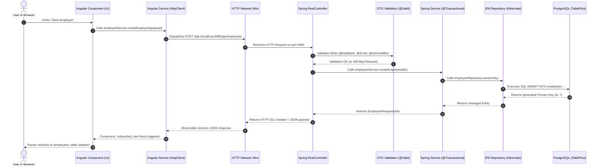

# Day 4 Presentation: The Full Request Lifecycle & "The Code Detective"
**Target Audience:** Senior Enterprise Engineers  
**Duration:** 1 Day (Morning: The 10-Step End-to-End Request Lifecycle / Afternoon: Tracing Existing Features & Validation)

---

## Slide 1: Welcome to Day 4 — The "Detective" Day
- **The Core Competency:** When an engineer joins an enterprise project at the Ministry of Finance, they are rarely asked to write code from scratch. They are asked to:
  - *"Trace why button X doesn't save field Y."*
  - *"Add a new field to an existing screen and persist it to PostgreSQL."*
  - *"Investigate why a user receives error 400 or 500."*
- **Today's Mission:** Tracing a single user action from the browser UI button all the way through the 5 tiers to the database disk and back.

---

## Slide 2: The 10-Step Journey of a Web Request



---

## Slide 3: Step 1 to 3 — The Client Side & Network Wire

### 1. The Trigger in HTML ([`employee-form.component.html`](../../frontend/src/app/components/employee-form/employee-form.component.html)):
```html
<form [formGroup]="employeeForm" (ngSubmit)="onSubmit()">
  <input formControlName="firstName" />
  <button type="submit">Enregistrer</button>
</form>
```
- The event `(ngSubmit)="onSubmit()"` captures the user form submission.

### 2. The Component Method ([`employee-form.component.ts`](../../frontend/src/app/components/employee-form/employee-form.component.ts)):
```typescript
const payload: EmployeeRequest = this.employeeForm.value;
this.employeeService.createEmployee(payload).subscribe({
  next: () => this.router.navigate(['/employees']),
  error: (err) => this.serverErrorMessage = err.error.message
});
```

### 3. The Wire Payload (Visible in Chrome DevTools `F12` $\rightarrow$ Network):
- Header: `POST /api/employees HTTP/1.1`
- Content-Type: `application/json`
- Request Body:
  ```json
  {
    "matricule": "FIN-2026-007",
    "firstName": "Karim",
    "lastName": "BENALI",
    "email": "k.benali@finances.gov",
    "salary": 145000,
    "hireDate": "2026-11-15",
    "status": "ACTIVE",
    "departmentId": 1
  }
  ```

---

## Slide 4: Step 4 to 6 — Entry into Spring Boot & Validation

Open [`EmployeeController.java`](../../backend/src/main/java/com/finances/ems/controller/EmployeeController.java) in Eclipse:

```java
@PostMapping
public ResponseEntity<EmployeeResponseDto> createEmployee(
    @Valid @RequestBody EmployeeRequestDto requestDto
) {
    EmployeeResponseDto created = employeeService.createEmployee(requestDto);
    return ResponseEntity.status(HttpStatus.CREATED).body(created);
}
```

### What Happens Here:
1. **Jackson JSON Deserializer:** Translates the incoming raw JSON string into a Java `EmployeeRequestDto` instance.
2. **`@Valid` Annotation:** Triggers Jakarta Bean Validation before any business code executes.
3. Open [`EmployeeRequestDto.java`](../../backend/src/main/java/com/finances/ems/dto/EmployeeRequestDto.java):
   ```java
   @NotBlank(message = "Le matricule est obligatoire")
   String matricule,
   @Email(message = "Format email invalide")
   String email,
   @DecimalMin(value = "0.0", message = "Le salaire doit être positif")
   BigDecimal salary
   ```

---

## Slide 5: The Fallacy of Client-Side Validation

> **Crucial Enterprise Principle:** Why do we validate in Angular if Spring Boot validates anyway?

| Type of Validation | Where It Runs | Purpose | Can It Be Bypassed? |
| :--- | :--- | :--- | :--- |
| **Frontend Validation (Angular Reactive Forms)** | Browser JavaScript engine. | **User Experience (UX).** Gives immediate feedback before waiting for network latency (red borders, helper text). | **YES.** Anyone can open Postman, Curl, or Chrome DevTools and send invalid JSON directly to port 8080. |
| **Backend Validation (`@Valid` in Spring Boot)** | Application server JVM. | **Integrity & Security.** Guarantees that corrupted or malicious data never reaches PostgreSQL. | **NO.** It is the authoritative gatekeeper of the enterprise database. |

---

## Slide 6: Step 7 to 8 — The Service Layer, Business Rules & SQL

Open [`EmployeeService.java`](../../backend/src/main/java/com/finances/ems/service/EmployeeService.java) in Eclipse:

```java
@Transactional
public EmployeeResponseDto createEmployee(EmployeeRequestDto dto) {
    // 1. Business rule check: Uniqueness of matricule & email
    if (employeeRepository.existsByMatriculeIgnoreCase(dto.matricule())) {
        throw new DuplicateResourceException("Matricule already exists");
    }
    // 2. Fetch associated Department from DB
    Department dept = departmentService.getDepartmentEntityById(dto.departmentId());
    
    // 3. Map DTO to JPA Entity
    Employee emp = new Employee();
    applyDtoToEntity(dto, emp, dept);
    
    // 4. Save to PostgreSQL via Hibernate
    Employee saved = employeeRepository.save(emp);
    
    // 5. Convert saved Entity back to Response DTO
    return toResponseDto(saved);
}
```

### Notice:
- DTOs enter and exit the controller.
- Entities are private to the service and repository layers.
- If an exception occurs, `@Transactional` rolls back any pending database writes.

---

## Slide 7: Handling Errors Cleanly — `@RestControllerAdvice`

What happens when validation fails or an ID is not found?

Without centralized handling, Spring Boot returns a raw HTML error page with a Java stack trace (ugly and confusing for the frontend).

Open [`GlobalExceptionHandler.java`](../../backend/src/main/java/com/finances/ems/exception/GlobalExceptionHandler.java):
```java
@RestControllerAdvice
public class GlobalExceptionHandler {
    @ExceptionHandler(MethodArgumentNotValidException.class)
    public ResponseEntity<Map<String, Object>> handleValidationErrors(...) {
        // Formats errors into a clean JSON map of field -> message
        return ResponseEntity.status(HttpStatus.BAD_REQUEST).body(errorMap);
    }
}
```

- When validation fails, Angular receives a standardized JSON error with HTTP `400 Bad Request` and can highlight the exact faulty field in red!

---

## Slide 8: Afternoon Hands-on Activity — The Code Detective Lab

1. **Exercise 1: Tracing an Existing Field:**
   - Pick the field `phone` in an employee record.
   - Trace it through all 5 layers:
     - Database: `init.sql` (column `phone VARCHAR(30)`)
     - Backend Entity: `Employee.java` (private field `phone`)
     - Backend DTO: `EmployeeRequestDto.java` & `EmployeeResponseDto.java`
     - Backend Service: `EmployeeService.java` (`applyDtoToEntity`)
     - Frontend Model: `employee.model.ts`
     - Frontend Form: `employee-form.component.ts` & `employee-form.component.html`
2. **Exercise 2: Inducing and Observing Errors:**
   - In Swagger UI or Angular, submit an invalid email: `admin@`.
   - Inspect the network response (`400 Bad Request`).
   - Find the exact line in `GlobalExceptionHandler.java` that generated that response.
