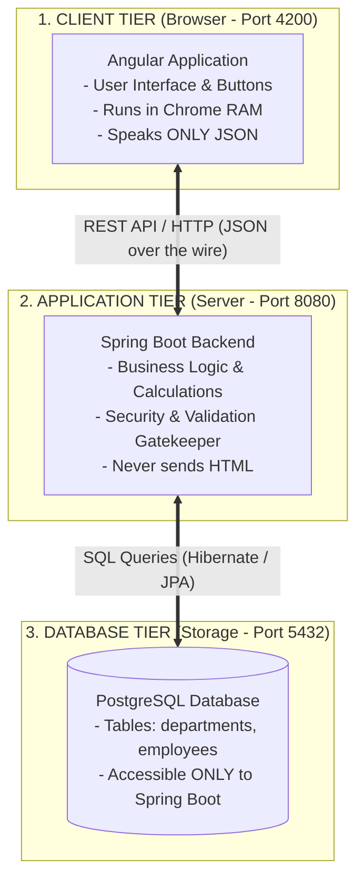
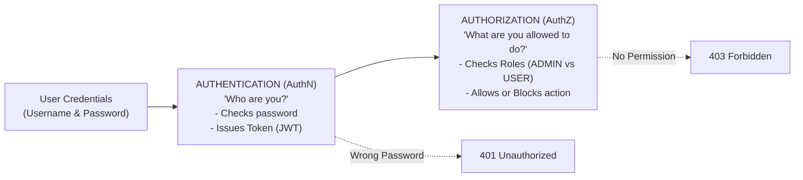
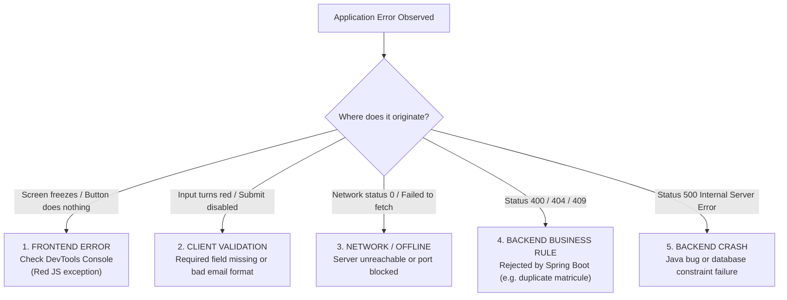

# Deliverable 03: Presentation Slides Content & Speaker Notes
## Workshop: Working with Modern Web Applications — Angular Frontend & Spring Boot Backend
**Format:** Projector-Ready Markdown Slide Deck with Speaker Notes  
**Total Slides:** 16  
**Audience:** Senior Enterprise Engineers (Non-Programmers)  

---

## Slide 1: Welcome & Course Title

### Title: Working with Modern Web Applications
**Subtitle:** Understanding, Operating, and Investigating Decoupled Architectures (Angular + Spring Boot)  
**Target:** Ministry of Finance / SIT Technical Teams  
**Date & Location:** Day 3 Hands-On Workshop  

#### Visual / Bullet Points:
- Operational understanding over coding syntax.
- 20% Theory • 20% Demonstration • 60% Hands-On.
- Your goal today: Become skilled technical investigators and communicators.

> **Speaker Notes:**
> Good morning everyone. Welcome to Day 3. Today is a practical, computer-based workshop. You are not here to memorize Java or TypeScript syntax. You are here to understand how modern web systems work, inspect them with professional tools, and bridge the gap between business operations and software developers.

---

## Slide 2: Workshop Objectives & Ground Rules

### Title: What You Will Achieve Today

#### Visual / Bullet Points:
1. **Understand Decoupled Architecture:** Why the dining room (Angular) is separate from the kitchen (Spring Boot).
2. **Operate Existing Systems:** Master navigation, data filtering, and business CRUD workflows.
3. **Inspect the Wire:** Use Chrome DevTools (Network & Console) to see real HTTP traffic.
4. **Diagnose Common Failures:** Differentiate frontend, backend, validation, and network errors.
5. **Report with Evidence:** Write structured, reproducible bug reports that developers love.

#### The Golden Rule:
- ❌ **No coding required today.**
- ✅ **Look under the hood, gather evidence, and ask questions anytime!**

> **Speaker Notes:**
> Let's set clear ground rules: you do not need to write code. Do not worry about breaking anything. The environment on your machine is isolated and safe. Whenever you have a question or notice an interesting message, speak up immediately!

---

## Slide 3: Client-Server Architecture (The Restaurant Model)

### Title: The 3 Tiers of a Modern Decoupled System



> **Speaker Notes:**
> This diagram is the most important concept of the morning. Notice the separation:
> 1. Angular is the dining room. It runs inside your browser. It has ZERO direct connection to PostgreSQL.
> 2. Spring Boot is the kitchen. It validates the request, checks security, and queries the database.
> 3. PostgreSQL is the locked ingredient pantry.
> Angular never speaks SQL. It only speaks HTTP and JSON to Spring Boot.

---

## Slide 4: Angular's Role: The Dynamic Frontend

### Title: Angular — Running in Your Browser

#### Visual / Bullet Points:
- **Client-Side Execution:** The application code is downloaded once and runs entirely in your browser's memory.
- **Single Page Application (SPA):** Screen navigation happens without full-page reloads or white flickering.
- **Component Model:** The screen is built from reusable Lego blocks:
  - Navbar Component (top navigation)
  - KPI Summary Component (calculated totals)
  - Table Component (employee list)
  - Form Component (create / edit modal)
- **Instant Responsiveness:** User clicks are handled immediately by local JavaScript.

> **Speaker Notes:**
> In old websites, every click forced the browser to download a new HTML page. In Angular, the browser downloads the application once. When you click around, Angular swaps screen components dynamically in memory. This gives the speed and feel of a desktop application.

---

## Slide 5: Spring Boot's Role: The Secure Backend

### Title: Spring Boot — The Authoritative Engine

#### Visual / Bullet Points:
- **Runs on the Server:** Executes on port `8080` in the application server environment.
- **API Provider:** Exposes endpoints like `/api/employees` and `/api/departments`.
- **The Security & Integrity Boundary:**
  - Verifies user permissions.
  - Enforces administrative business rules (e.g., unique matricule).
  - Performs authoritative validation (`@Valid`).
- **Database Custodian:** Executes SQL queries against PostgreSQL via Hibernate.
- **Headless:** Spring Boot generates **zero HTML**; it outputs only pure, machine-readable JSON data.

> **Speaker Notes:**
> Spring Boot is the authoritative gatekeeper. You can never trust data coming from a browser because anyone can tamper with client code. Spring Boot verifies every single request before writing to PostgreSQL. If data is invalid, it returns a clean error code.

---

## Slide 6: The Wire — REST API Communication

### Title: REST APIs — The Universal Wire Treaty

```text
[ Angular Frontend ]  ---- (1) HTTP Request: GET /api/employees ---->  [ Spring Boot Backend ]
[ Port 4200        ]  <--- (2) HTTP Response: 200 OK + JSON List ---   [ Port 8080         ]
```

#### What is a REST API?
- **RE**presentational **S**tate **T**ransfer.
- A standardized architectural style for exchanging data across a network using standard **HTTP**.
- **Stateless:** Each request contains all information needed to process it; the server does not store conversational memory in RAM.
- **Language-Agnostic:** Java on the backend talks seamlessly to TypeScript/JavaScript on the frontend.

> **Speaker Notes:**
> The REST API is the contract between the two worlds. Because it uses standard HTTP and JSON, it doesn't matter that the frontend is written in TypeScript and the backend in Java. In fact, a mobile app or another Ministry portal could consume this exact same API without changing a line of backend code!

---

## Slide 7: The 4 Core HTTP Methods

### Title: HTTP Verbs — Standard Actions on Resources

| HTTP Verb | Action Meaning | Example in EMS | Safe / Idempotent? |
| :--- | :--- | :--- | :--- |
| **`GET`** | **Read / Retrieve** resource data | `GET /api/employees` | ✅ Safe (never alters data) |
| **`POST`** | **Create** a brand-new resource | `POST /api/employees` | ⚠️ Creates new database record |
| **`PUT`** | **Update / Replace** an existing resource | `PUT /api/employees/5` | ⚠️ Replaces record with ID 5 |
| **`DELETE`**| **Remove** an existing resource | `DELETE /api/employees/5` | ⚠️ Permanently deletes record |

> **Speaker Notes:**
> Notice how clean REST URLs are. In older RPC systems, you saw messy URLs like `/deleteEmployeeById?id=5`. In REST, the URL always identifies the resource (`/api/employees/5`), and the HTTP Verb dictates the action (`DELETE`).

---

## Slide 8: JSON — The Language-Agnostic Wire Format

### Title: JSON (JavaScript Object Notation)

```json
{
  "id": 1,
  "matricule": "FIN-2026-001",
  "firstName": "Karim",
  "lastName": "BENALI",
  "email": "k.benali@finances.gov",
  "salary": 145000.00,
  "status": "ACTIVE",
  "departmentCode": "SIT"
}
```

#### Why JSON is the Industry Standard:
- **Human-Readable:** Plain text that anyone can read and understand.
- **Lightweight:** No heavy XML tags or SOAP envelopes.
- **Native Support:** Supported natively in every browser and programming language.

> **Speaker Notes:**
> This is what actually flies over the Ethernet cable or Wi-Fi. It is simple text structured in key-value pairs. Numbers, text, lists, and booleans. When Spring Boot sends this text, Angular instantly converts it into visual table rows.

---

## Slide 9: HTTP Status Codes — The Universal Error Language

### Title: Status Codes — The 3-Digit Health Report

```text
2xx = SUCCESS           4xx = CLIENT / REQUEST ERROR       5xx = SERVER CRASH
200 OK                  400 Bad Request (Validation)       500 Internal Server Error
201 Created             401 Unauthorized (Who are you?)
204 No Content          403 Forbidden (Not allowed!)
                        404 Not Found (Wrong ID/URL)
                        409 Conflict (Duplicate data)
```

#### Golden Rule for Technical Investigators:
- **`4xx` Errors:** The request was malformed, invalid, or unauthorized by the user.
- **`5xx` Errors:** The server crashed due to an unhandled exception or database failure.

> **Speaker Notes:**
> As an investigator, the HTTP status code is your primary compass. If you see a 400 or 409, the server is healthy; it rejected the user's input because a rule was violated. If you see a 500, a programmer's code crashed on the server.

---

## Slide 10: Authentication vs. Authorization

### Title: Who Are You? vs. What Can You Do?



#### Clear Distinction:
- **Authentication (AuthN):** Proving your identity. (*Failure = `401 Unauthorized`*).
- **Authorization (AuthZ):** Verifying your permissions. (*Failure = `403 Forbidden`*).

> **Speaker Notes:**
> These two terms are frequently confused. Authentication is your passport at the border: it proves who you are. Authorization is your diplomatic visa: it dictates which rooms you are allowed to enter. If you have no badge, you get a 401. If you have a regular badge but try to enter the Treasury vault, you get a 403.

---

## Slide 11: Frontend vs. Backend Validation

### Title: Two Lines of Defense

| Feature | Frontend Validation (Angular) | Backend Validation (Spring Boot) |
| :--- | :--- | :--- |
| **Where It Runs** | In Chrome browser memory. | On the application server. |
| **Purpose** | **User Experience (UX):** Immediate helper text, red borders. | **Data Security & Integrity:** Protects the PostgreSQL database. |
| **When It Runs** | Instantly as the user types or clicks. | When the HTTP request reaches port 8080. |
| **Can It Be Bypassed?** | **YES.** Anyone can use DevTools or Postman to bypass it. | **NO.** Authoritative gatekeeper. |
| **Result on Failure** | UI error label; button disabled. | HTTP `400 Bad Request` or `409 Conflict`. |

> **Speaker Notes:**
> Never rely on frontend validation for security! Client-side checks are purely for user convenience so people don't have to wait for network round-trips to fix obvious typos. The backend must always re-validate every single field.

---

## Slide 12: Chrome Developer Tools: Your Technical Microscope

### Title: Looking Under the Hood with DevTools (`F12`)

#### The Two Essential Tabs for Non-Developers:

1. **The Console Tab:**
   - The browser's black-box flight recorder.
   - Shows uncaught JavaScript exceptions in **bright red**.
   - Your first stop when a button clicks but "nothing happens".

2. **The Network Tab:**
   - The wire surveillance camera.
   - Shows every HTTP request, status code, URL, and payload.
   - Setup: Check **"Preserve log"** and select filter **"Fetch/XHR"**.

> **Speaker Notes:**
> Chrome DevTools is built into every computer in the world. You do not need admin rights or special licenses. Pressing F12 turns your browser from a passive viewing screen into an advanced technical diagnostic instrument.

---

## Slide 13: Anatomy of Application Errors

### Title: Diagnosing Where a Problem Lives



> **Speaker Notes:**
> When an end-user says 'the app is broken', this chart helps you pinpoint the layer within 30 seconds. Is it a client script crash? An invalid input? A network disconnect? Or a backend 500 error?

---

## Slide 14: The Art of Professional Bug Reporting

### Title: Writing Bug Reports Developers Respect

#### The Bad Report vs. The Golden Report:
- ❌ **Useless Report:** *"The employee page doesn't work. Fix it ASAP."*
- ✅ **Golden Professional Report:**
  1. **Title:** Clear, descriptive summary.
  2. **Environment & User:** URL, Browser, User Role (`ADMIN`).
  3. **Exact Steps to Reproduce:** Numbered 1, 2, 3 click sequence.
  4. **Expected vs Actual Behavior:** What should happen vs what happened.
  5. **Technical Evidence:**
     - Endpoint: `POST http://localhost:8080/api/employees`
     - Status: `409 Conflict`
     - Response: `{"message": "Matricule 'FIN-2026-001' already exists"}`
     - Redacted screenshot attached!

> **Speaker Notes:**
> Developers don't argue with technical evidence. When you hand a developer a ticket with exact reproduction steps, the HTTP status code, and the response payload, they can locate the faulty file and fix it in 15 minutes without back-and-forth emails.

---

## Slide 15: Final Practical Assessment Challenge

### Title: The 3-Scenario Diagnostic Challenge

#### Your Task (Final 20 Minutes):
1. **Scenario A:** A form refuses to submit. Identify the validation rule preventing submission.
2. **Scenario B:** A record deletion fails with `HTTP 403 Forbidden`. Identify the missing permission.
3. **Scenario C:** A submission returns `HTTP 500 Internal Server Error`. Capture the technical evidence and write a complete bug report.

#### What We Evaluate:
- Accuracy of technical evidence (URL, Method, Status Code).
- Clarity of reproduction steps.
- Safe handling of sensitive information (no unredacted passwords!).

> **Speaker Notes:**
> In our final session this afternoon, you will test your diagnostic skills on three realistic scenarios. You will use Chrome DevTools, capture the evidence, and write one complete bug report using our standard template.

---

## Slide 16: Workshop Recap & Core Takeaways

### Title: Summary of Core Principles

#### Remember These 5 Golden Rules:
1. **Decoupled Architecture:** Angular (port 4200) only talks to Spring Boot (port 8080) via REST/JSON. It never talks to PostgreSQL directly.
2. **REST Verbs:** `GET` reads, `POST` creates, `PUT` updates, `DELETE` deletes.
3. **Status Codes:** `2xx` is success, `4xx` is client error, `5xx` is server failure.
4. **DevTools is Your Ally:** The Network tab reveals the wire; the Console reveals browser crashes.
5. **Evidence Over Emotion:** A status code and request payload turn an argument into a solved problem.

**Congratulations on completing Day 3!**

> **Speaker Notes:**
> Thank you all for your active participation today. You have successfully navigated the entire stack from the browser interface down to the network wire. You now possess the vocabulary and diagnostic skills to lead modernization efforts across the Ministry!
